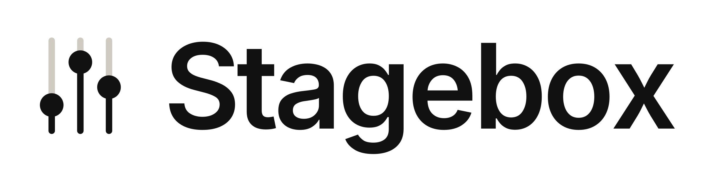

<h1>
  <picture>
    <source media="(prefers-color-scheme: dark)" srcset="app/Resources/logo/stagebox-logo-dark.png">
    
  </picture>
</h1>

(Tidigare *GuitarFX*. Repot på GitHub heter fortfarande `guitar-fx`.)

Egen gitarreffektprocessor: chorus, flanger, reverb och distortion. Utvecklas på Mac
med Focusrite Scarlett och är byggd för att flyttas till iPad (live) och eventuellt
Raspberry Pi eller egen pedal.

## Status (v0.9 – Stagebox: stämfält längst ned, stämningar, låtanalys)

- Portabel DSP-kärna och ljudmotor utan beroenden (`dsp/`, `engine/`)
- **Ingångssteg för akustisk gitarr:** Ingång 1, Ingång 2 eller **Blanda 1 + 2**
  (t.ex. mikrofon + inbyggd mikrofon), balans, polaritetsvändning per ingång och
  tidsjustering med **Auto-justera** (mäter fördröjning och polaritet medan du spelar).
  Mono ut på alla utgångar (dual mono).
- Säkerhetslimiter sist i kedjan (−1 dBFS tak, NaN/Inf-skydd, automatisk återställning)
- Effektkedja med klickfri bypass (15 ms crossfade)
- **Grundljud + presets:** grundljudet (t.ex. EQ och lite reverb) ligger alltid på. Presets
  är en eller flera effekter med egna inställningar som aktiveras ovanpå – ett i taget,
  tryck igen för att gå tillbaka till grundljudet. Styrs med knapparna, tangenter eller
  MIDI-fotswitch (även Bluetooth). Reverbsvansen klingar ut naturligt vid byte.
- **EQ:** lågskärning, bas, mitt (valbar frekvens), diskant och smal notch mot rundgång.
- **Rundgångsskydd:** lyssnar efter toner som ringer upp (rena toner utan övertoner som inte
  klingar av) och lägger smala filter (Q 30) på just de frekvenserna – −9 dB först, djupare
  om tonen fortsätter. Vanligt spel lämnas orört. Upp till 8 filter; de syns som staplar i
  panelen och **Nollställ** tömmer dem (t.ex. efter soundcheck). På i grundljudet. Ingen latens.
- **Kropp (kroppsklang):** gör den inbyggda pickupens hårda ljud mer likt en mikrofon –
  kroppens resonanser och mindre "kvack". Typerna Dreadnought, Jumbo, Auditorium och Parlor,
  mängd och luft.
- **Dubblare och oktav:** två svävande röster i stereo (som två tagningar) och oktav upp för
  en tolvsträngad känsla.
- **Tremolo:** hastighet, djup, form (mjuk–hård) och stereo (vänster/höger i motfas).
- **Delay:** tempo (BPM) och indelning (1/4, 1/8 punkterad, 1/8, 1/16), återkoppling,
  dämpning och mix. **Tap tempo** med knappen i delayns panel, mellanslag eller fotswitch
  (MIDI CC 107). Låtanalysen sätter delayns tempo efter låten. Svansen klingar ut vid byte.
- **Volym och boost:** nivå per preset (så att alla låtar låter lika starkt) och en solo-boost
  uppe till höger (B / MIDI CC 106) som höjer med inställd mängd oavsett preset.
- **Skärmsläckare:** välj i rullgardinen uppe till höger – *Ingen skärmsläckare*, *Strömmar*,
  *Klot*, *Terräng* eller *Form*. Monokroma punkteffekter som styrs av gitarren (nivå, bas,
  diskant, anslag), alltid mörka och helt utan text. Startar efter 1, 5 (standard) eller 15
  minuter utan mus, beröring, tangent eller pedal; *Visa nu* provar direkt. Första
  beröringen/tangenten väcker bara – den trycker inte på något i appen. Ljudet påverkas aldrig.
- **Låtanalys → gitarrens plats i bandet:** välj en inspelning av låten (WAV/AIFF/FLAC/MP3/M4A).
  Appen lyssnar på var bas, kick, sång och rum tar plats och föreslår ett preset där gitarren
  passar in i bandet – den härmar inte hela låten. Allt sker lokalt.
- **Stämapparat alltid synlig:** ett lågt fält längst ned visar ton, skala −50…+50 cent,
  avvikelse och strängarna i vald stämning (Standard, Drop D, halvton/helton ner, Drop C,
  DADGAD, Open G/D/E/C eller Kromatisk). **Mute** (eller T / MIDI CC 105) stänger av ljudet
  ut medan du stämmer – då blir fältet svart. Referens A4 430–446 Hz. Noggrannhet < 1 cent.
- **Sustain:** kompressor för längre ton – sustain, anslag, släpp, nivå och mix
  (parallellkompression som behåller anslaget). Visar hur mycket den komprimerar.
- **Widener:** bredare stereo med mitt/sida-teknik – exakt monokompatibel (L+R = originalet).
- **Utgång Stereo / Mono (summa):** mono om bara en kanal går till mixern.
- **Monokromt GUI med lodräta reglage:** varm off-white (eller mörkt), ett gemensamt rutnät,
  presets som en setlist till vänster, effekterna som rutor i sju kolumner (svart = på) och reglagen i lika
  stora rutor som fyller höjden;
  en smal nivåmätare i sidhuvudet visar bara de ingångar som används. Eget appfönster utan JUCE:s "Options"-rad. Utseende: följ
  systemet, ljust eller mörkt (⋯ → Utseende). Typsnitt: Inter (inbäddat, OFL-licens).
- **Chorus** (hastighet, djup, mix) och **Flanger** (hastighet, djup, återkoppling, mix),
  båda i stereo: vänster och höger sveper i olika fas.
- **Reverb** (FDN med 8 linjer): efterklang 0,3–10 s, storlek, predelay, dämpning,
  lågskärning på efterklangen och mix. Efterklangstiden stämmer med inställningen
  (testat), och slingan är stabil för alla inställningar.
- **Distortion** med 4x oversampling (halvbands-FIR, ~0,58 ms latens vid 48 kHz):
  lägena Overdrive / Distortion / Fuzz, rattar Drive, Tight (lågskärning före
  klippning), Ton och Nivå. Uppmätt aliasing < −100 dB (7 kHz-ton, 24 dB drive).
- **Kabinett** med IR-faltning utan latens (direkt huvud + partitionerad FFT-svans).
  Inbyggt syntetiskt 1x12-svar, eller ladda egen IR (WAV/AIFF, valfri
  samplingsfrekvens – samplas om automatiskt, normaliseras, max 0,5 s).
  Byte av IR under spelning är låsfritt.
- **Latensmätning** i appen: loopback-kabel ut → in, knappen "Mät latens".
- JUCE-app: Standalone + AU/VST3 (Mac), AUv3 (iOS), VST3 (Linux)
- Scen-GUI v1: nivåer, distortion, kabinett, mätare, CPU, limiter, watchdog-varning
- Offline-verktyg `gfx-render` (med effekterna) och 19 tester (inkl. att ljudtråden
  inte allokerar minne och att IR-byte från annan tråd är säkert)

## Struktur

```
dsp/            Ren C++20. Effect-interface, buffrar, parametrar, effekter.
  core/         Biquad, DelayLine/Lfo, Oversampler4x, FFT, Convolver, PitchDetector,
                Parameter, DspUtils
  effects/      Gain, SafetyLimiter, Eq, Sustain, Distortion, Cabinet, Chorus, Flanger,
                Widener, Reverb
engine/         InputMixer, effektkedja, Engine (ingång → in-gain → kedja → ut-gain →
                limiter), LatencyProbe, TunerTap, Rig (grundljud + presets), SongAnalyzer.
app/Source/ui/  Tema (monokromt, Inter), ikoner och GUI-komponenter.
app/Resources/  Typsnitt (Inter, SIL Open Font License).
app/            JUCE-skal (Standalone/plugin) + GUI. Endast limkod.
tools/          gfx-render: kör motorn på WAV-filer.
tests/          Beroendefria tester.
presets/        (kommer) JSON-presets.
```

Regel: `dsp/` och `engine/` får aldrig inkludera JUCE. Det är det som gör att samma
kod kan köras på iOS, Raspberry Pi och mikrokontroller.

## Bygga på Mac

Krav: Xcode (med kommandoradsverktyg) och CMake (`brew install cmake`).
JUCE 9.0.6 hämtas automatiskt vid första konfigureringen.

```bash
# Xcode-projekt (rekommenderas för att köra/debugga appen)
cmake -B build -G Xcode
open build/Stagebox.xcodeproj      # välj schemat "Stagebox_Standalone" och kör

# Eller kommandoraden
cmake -B build -DCMAKE_BUILD_TYPE=Release
cmake --build build --config Release -j
ctest --test-dir build -C Release --output-on-failure
```

Appen hamnar i `build/app/Stagebox_artefacts/<Config>/Standalone/Stagebox.app`.

### Första körningen med Scarlett

Utgångarna på baksidan heter **Left** och **Right** (= utgång 1 och 2). Stagebox skickar
samma signal på båda; använd **Left** till mixer/PA. Hörlurar i Scarlettens hörlursuttag.
Ingång och utgång måste vara **samma ljudenhet** (Scarlett), annars ökar latensen kraftigt.

1. Koppla gitarren till **ingång 1** och slå på **INST** på Scarlett
   (eller se avsnittet om akustisk gitarr nedan för mikrofon + inbyggd).
2. Starta appen → **⋯ → Ljudinställningar…**: välj Scarlett 2i2 som både utgång och
   ingång, kryssa i kanal 1 + 2 för båda, 48 kHz och buffertstorlek 64.
3. Använd hörlurar eller förstärkare, inte datorns högtalare (rundgång).
4. Ställ in gain på Scarlett så att IN-mätaren ligger kring gul vid hårt anslag.

## Bygga Stagebox.app och .dmg

På en Mac med Xcode och CMake:

```bash
./scripts/build-mac.sh
```

Skriptet bygger en universell app (Apple Silicon + Intel), kör testerna, signerar ad hoc och
lägger `Stagebox.app` och `Stagebox-<version>.dmg` i `dist/`. Bara Apple Silicon (snabbare):
`ARCHS=arm64 ./scripts/build-mac.sh`.

**Automatiskt på GitHub:** varje push till `main` bygger samma .dmg på en Mac i GitHub
Actions. Hämta den under *Actions → Bygg → senaste körningen → Artifacts → Stagebox-dmg*.

Appen är inte signerad med ett Apple-utvecklarcertifikat. Första gången på en ny Mac:
högerklicka på Stagebox → **Öppna** → **Öppna** (eller
`xattr -dr com.apple.quarantine /Applications/Stagebox.app`). För att slippa det krävs ett
betalt Apple Developer-konto (Developer ID-signering och notarisering).

## iPad

Samma kod som Mac-versionen. Appen körs i helskärm, liggande, på iPad med iPadOS 16 eller
senare (iPad mini och uppåt). Ljudkort: allt som fungerar utan drivrutiner (class compliant),
t.ex. Scarlett 2i2, iRig Pro Duo / Pro I/O / HD. Exporterade presets och kopierade IR:er
syns i Filer-appen under *På min iPad → Stagebox*. Även en AUv3-plugin byggs (för AUM,
GarageBand m.fl.).

Kräver **hela Xcode** (App Store) och ett Apple-ID inlagt i Xcode (*Xcode → Settings → Accounts*).

```bash
cmake -B build-ios -G Xcode -DCMAKE_SYSTEM_NAME=iOS -DCMAKE_OSX_DEPLOYMENT_TARGET=16.0
open build-ios/Stagebox.xcodeproj
```

I Xcode: välj schemat **Stagebox_Standalone** och din iPad som mål (anslut med kabel första
gången och godkänn *Lita på den här datorn*). Under *Signing & Capabilities* för målen
Stagebox_Standalone och Stagebox_AUv3: kryssa *Automatically manage signing* och välj ditt
Team. Tryck **Kör** (▶). Första gången: på iPaden, *Inställningar → Allmänt → VPN och
enhetshantering* → lita på ditt utvecklarcertifikat, och slå på *Utvecklarläge*
(*Inställningar → Integritet och säkerhet*).

Gratiskonto: appen slutar starta efter 7 dagar och måste installeras om. Betalt konto
(99 USD/år) – ett år, och TestFlight för att installera utan kabel.

CI bygger iPad-versionen vid varje ändring och tar skärmdumpar i simulatorn (iPad Pro 13"
och iPad mini) – se *Actions → körningen → Artifacts → Stagebox-ipad-skarmdumpar*.

## Linux / Raspberry Pi (senare)

Samma CMake-bygge fungerar (verifierat på Ubuntu 24.04 x86_64). Kräver bl.a.
`libasound2-dev libfreetype-dev libfontconfig1-dev libx11-dev libxrandr-dev
libxinerama-dev libxcursor-dev libxext-dev libxi-dev`. För en huvudlös pedal på Pi
byggs i stället ett litet ALSA/JACK-värdprogram runt `gfx::Engine`.

## Akustisk gitarr: mikrofon, inbyggd eller båda (Scarlett 2i2)

| | Ingång | Scarlett |
|---|---|---|
| Mikrofon mot gitarren | 1 (XLR) | INST av, 48V på om kondensatormikrofon |
| Gitarrens inbyggda mikrofon | 2 (teleplugg) | INST på (passiv mikrofon) |

Öppna **⋯ → Ingång och utgång…** och välj **Källa**:
- **Ingång 1** eller **Ingång 2** – bara en av dem.
- **Blanda 1 + 2** – båda. Den inbyggda ger stabilitet mot rundgång, mikrofonen ger luft.
  1. Ställ gain på Scarletten så att IN 1 och IN 2 ligger ungefär lika (gult vid hårt anslag).
  2. Tryck **Auto-justera** och spela i ungefär en sekund (gärna ackord). Appen mäter hur
     mycket senare mikrofonen hör gitarren och om polariteten är omvänd, och justerar.
  3. Ställ **Balans** efter smak (0 = bara ingång 1, 1 = bara ingång 2).

Utan justering släcker mikrofonen och den inbyggda delvis ut varandra och det låter tunt.
Flytta du mikrofonen: kör Auto-justera igen. **Ø**-knapparna vänder polariteten manuellt –
prova dem också om det börjar tjuta, ibland flyttar det rundgången.

Mikrofonplacering: riktad mot där halsen möter kroppen (12:e–14:e bandet), 15–30 cm bort.
Mot ljudhålet blir det mycket bas. Distortion och kabinett ska vara **av** för akustisk gitarr.

### Effekter för akustisk gitarr – startinställningar

Kedjan är: distortion → kabinett → **chorus → flanger → reverb**. Allt är av vid start.

- **Reverb** – det viktigaste. Börja med efterklang 1,5–2,5 s, mix 0,2–0,3, predelay
  10–25 ms (håller anslaget tydligt). Höj **Lågskärning** (150–250 Hz) om det blir grötigt
  i PA:t, sänk **Dämpning** (4000–6000 Hz) för en varmare, mindre "glasig" svans.
- **Chorus** – låg hastighet (0,3–0,8 Hz), djup 0,3–0,5, mix 0,3. Ger bredd utan att
  gitarren låter ostämd.
- **Flanger** – mer en specialeffekt på akustisk gitarr; låg hastighet och mix 0,3
  för ett mjukt svep, hög återkoppling för en tydlig "jet"-effekt.

Stereo: chorus, flanger och reverb ger olika signal i Left och Right. Med bara Left till
mixern hörs effekterna fortfarande fullt ut (i mono). Koppla Right till en andra kanal
för stereo i PA:t.

## Grundljud och presets

**Grundljudet** är det som hörs när inget preset är aktivt. Välj **0 Grundljud**
överst i setlistan och ställ in EQ och de effekter som alltid ska vara på (t.ex. ett diskret rum).

**Gränssnittet:**
- Rutorna uppe till höger är effekterna. Tryck på en för att visa dess
  reglage nedanför. Effekterna står i signalordning och en svart ruta betyder att effekten
  är på. Reglagen är lodräta och alltid lika stora (sju platser – EQ har flest). Dra det
  svarta greppet uppåt/nedåt; dubbelklick återställer standardvärdet.
- Reglaget till höger om effektens namn slår på/av den.
- Vänster spalt är **setlistan**: grundljudet överst och sedan presets i spelordning. Dra en
  rad (handtaget ≡) för att flytta den; **‹ Föregående / Nästa ›** stegar genom listan – samma
  sak som ←/→, fotswitch eller Bluetooth-pedal (MIDI CC 102/103).
- Nivåmätaren uppe till höger visar insignalen – bara IN 1, IN 2 eller båda beroende på
  vald ingång. Röd = överstyrning. CPU, limiter, latens och MIDI visas i **⋯**-menyn.
- Alla inställningar finns under **⋯** uppe till höger: ingång och utgång, ljudinställningar,
  latensmätning, export/import av presets och utseende.
- Ikonen med ljudvågen bredvid **+** ovanför setlistan öppnar låtanalysen.

**Ett preset** är en eller flera effekter med egna inställningar:
1. Tryck **+** ovanför setlistan och ge presetet ett namn (det blir aktivt).
2. Ställ in effekterna. **Allt du ändrar sparas i det aktiva presetet** – en effekt du ändrar
   eller slår på tas automatiskt med (rutan visar I PRESET). Grundljudet påverkas inte.
3. Effekter du inte rör följer grundljudet. **Högerklick eller långt tryck på effektrutan** → "Följ grundljudet igen" tar bort effekten ur presetet (eller "Ta med i presetet").
4. Vill du ändra grundljudet: välj **0 Grundljud** först.

**Live:** tryck på en rad i setlistan för att aktivera det och på **0 Grundljud** för att gå
tillbaka. (Med tangenter och fotswitch går samma knapp igen tillbaka till grundljudet.) Byten glider mjukt och reverbsvansen klingar ut. Högerklick/långt
tryck på en rad ger meny för att byta namn, duplicera, flytta och ta bort. Allt sparas
automatiskt; **⋯ → Exportera/Importera presets** sparar en JSON-fil (backup, flytta till iPad).

Appen startar med exempel – *Stor hall*, *Chorus* och *Flanger-svep* – att ändra eller ta bort.

### Styra med fotswitch eller tangentbord

| Styrning | Funktion |
|---|---|
| Tangent **1–9** | Preset 1–9 (samma igen = grundljud) |
| **0** eller **Esc** | Grundljud |
| **←** / **→** (även Page Up/Down) | Föregående / nästa |
| MIDI **Program Change 0–8** | Preset 1–9 |
| MIDI **CC 102 / 103 / 104** (värde ≥ 64) | Föregående / nästa / grundljud |
| Tangent **T** eller MIDI **CC 105** | Mute (stämning) på/av |
| Tangent **B** eller MIDI **CC 106** | Boost på/av |
| **Mellanslag** eller MIDI **CC 107** | Tap tempo (delay) |

MIDI-ingångar (även Bluetooth-MIDI-pedaler som parats i macOS *Ljud-MIDI-inställningar*)
öppnas automatiskt. Ljudkort och MIDI väljs under **⋯ → Ljudinställningar…**. Pedaler som i stället
skickar tangenttryck (sidvändare för noter) fungerar direkt med ←/→ eller Page Up/Down.
Senast mottagna MIDI visas längst ned till höger.

## Låtanalys – gitarrens plats i bandet

Tryck på ikonen med ljudvågen bredvid **+** (eller ⋯ → Analysera låt…) och välj en inspelning
av låten. Analysen tar någon sekund och sker helt lokalt – inget laddas upp och ingen modell
laddas ner.

Målet är att gitarren ska **passa in i bandet**, inte låta som hela låten. Därför mäts var
mixen redan är full och gitarren får det som blir över (vanlig mixpraxis för akustisk gitarr):

| Område | Vad som mäts i låten | Blir för gitarren |
|---|---|---|
| Botten | Bas och kick/subbas (40–160 Hz) jämfört med en referenskurva för inspelad musik | Mycket bas → högre lågskärning (upp till 150 Hz) och basen sänks. Glest utan bas → gitarren får bära botten (85 Hz) |
| Lågmitt | Fullhet kring 200–400 Hz | Full mix (med bas) → gitarren sänks kring 300 Hz, mindre grötigt |
| Närvaro | Minst upptagna frekvensen i 2–5 kHz | En liten höjning i den "fickan", så att gitarren hörs bredvid sången |
| Diskant | Luft i mixen (5–11 kHz) | Mörk mix → gitarren står för luften. Ljus mix → lämnas |
| Rum | Stereo: koherens mellan vänster och höger. Mono: sen avklingning | Reverb lite torrare än låten (högst 15 % i ett fullt band) och predelay efter tempot |
| Dynamik | Spridning i korttidsnivå | Tät, komprimerad låt → sustain så att gitarren inte försvinner |
| Tempo | Anslagsrytm, 60–180 BPM | Delayns tempo (1/8 punkterad) – avstängd, slå på vid behov |

Ingen widener: gitarren ligger smal i bandet. **Skapa preset** lägger till ett preset med
låtens namn och aktiverar det – se det som en startpunkt och justera med öronen.

Provat på Creative Commons-inspelningar: ett rockband med tung kick gav lågskärning 150 Hz, bas
−3 dB och sustain; en glesare unplugged-låt (gitarr + sång) behöll botten (85 Hz) och fick en
liten närvarohöjning; en mörk bluegrassinspelning fick +3 dB diskant.

## Mäta latens (färdplanens steg 2)

1. Koppla bort förstärkare/hörlurar. Slå **av** INST på ingången och vrid ner gain.
2. Koppla en kabel från Scarletts **Line Out Left** (baksidan) till **ingång 1**.
3. Välj **⋯ → Mät latens…** och sedan **Starta**. Resultatet visas i vänster spalt. Appen skickar 5 klick på −12 dBFS och
   visar rundturslatensen (DAC + ADC + drivrutin + buffertar) i ms och samples.
   **Uppmätt (Mac + Scarlett 2i2, 48 kHz, buffert 64): 5,60 ms rundtur (269 samples).**
   Mycket bra för live – motsvarar att stå knappt 2 m från en förstärkare.
4. Prova olika buffertstorlekar (⋯ → Ljudinställningar) och anteckna resultaten.
   Effektlatensen (oversampling, för närvarande 28 samples) kommer ovanpå när
   distortion är på och visas i ⋯-menyn.

"Ingen signal" betyder att klicket inte kom tillbaka (kabel, fel ingång, för låg gain).
Stäng av Scarletts **Direct Monitor** (och Air) före mätningen. Med loopback-kabeln
skulle Direct Monitor annars skicka ingången rakt tillbaka till utgången – en
återkopplingsslinga som kan tjuta. Monitor-ratten styr nivån på Line Out Left/Right;
ställ den på ungefär halvvägs.

## Offline-verktyget

```bash
./build/tools/offline-render/gfx-render di-gitarr.wav ut.wav --in-gain 6
./build/tools/offline-render/gfx-render di-gitarr.wav ut.wav --drive 24 --mode 0 --tone 0.6 --cab
./build/tools/offline-render/gfx-render di-gitarr.wav ut.wav --drive 30 --mode 1 --ir min-ir.wav
./build/tools/offline-render/gfx-render --sine 220 --seconds 5 test.wav
```

Effekter: `--chorus 0.4` (mix), `--flanger 0.5` (mix), `--reverb 2` (efterklang i s,
med `--reverb-mix 0.25`). Filen förlängs så att efterklangen hinner klinga ut.

`--drive` slår på distortion (`--mode` 0 Overdrive, 1 Distortion, 2 Fuzz), `--cab` det
inbyggda kabinettet och `--ir` laddar en egen IR.

Spela in några torra DI-tagningar direkt från Scarlett och använd dem som
referens när effekterna utvecklas.

## Färdplan

1. ✅ Skelett, passthrough, limiter, tester
2. ✅ Mät latens rundtur på Mac + Scarlett 2i2: 5,60 ms vid 48 kHz, buffert 64
3. ✅ Distortion (waveshaper + 4x oversampling) och kabinett-IR (faltning)
   - Kvar: lyssningstest med riktiga DI-tagningar och finjustering av klangen
4. ✅ Akustisk ingång: mikrofon / inbyggd / blanda med auto-justering
5. ✅ Chorus, flanger och reverb (FDN)
6. ✅ EQ med notch, grundljud + presets, MIDI/tangenter
7. ✅ Sustain (kompressor), widener, mono-utgång, monokromt GUI (nu med lodräta reglage)
8. ✅ Stämapparat
9. ✅ Låtanalys → gitarrens plats i bandet (signalanalys, lokalt)
10. ✅ Delay med tap tempo, rundgångsskydd, kroppsklang, dubblare/oktav, tremolo, volym/boost
11. Looper; egna kropps-IR:er (faltning) som tillval
12. MIDI learn (valfria meddelanden per preset), scenläge med extra stora knappar
13. iOS-bygge och live-härdning (ljudsessionsavbrott, återanslutning av ljudkort)
14. (Valfritt) Raspberry Pi / Daisy Seed

## Live-säkerhet – regler som alltid gäller

- Ljudtråden: ingen allokering, inga lås, ingen loggning, ingen fil-I/O
  (testet `Realtidssäkerhet` fångar allokeringar).
- Säkerhetslimitern sitter alltid sist och kan inte förbikopplas.
- Varje ny effekt ska ha tester för: tystnad in → tystnad ut, ingen NaN vid extrema
  parametrar, och ingen allokering i `process()`.
- Strängar med å/ä/ö i JUCE-koden måste skrivas som `juce::String::fromUTF8("...")`
  (JUCE tolkar annars `const char*` som ASCII).
- Hårdvarumässig reservväg (ABY/true bypass-switch) före ljudkortet vid spelning.
